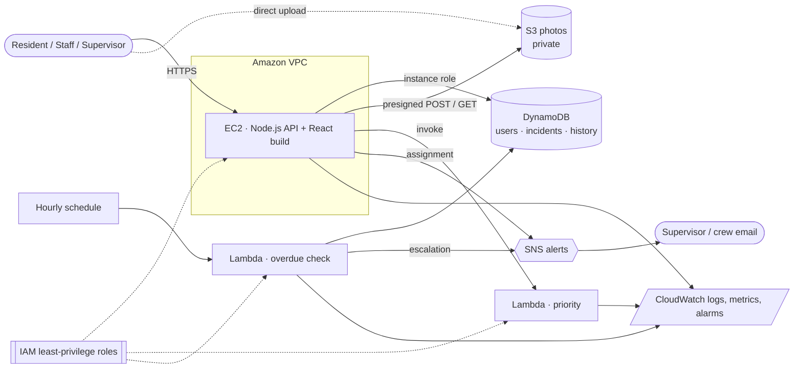
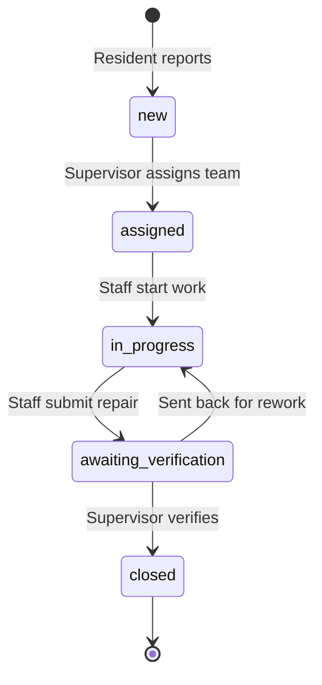

<div align="center">

# 🏙️ PulseCity

### See it. Report it. Watch it get fixed.

A civic issue platform where **residents report problems**, **rules prioritise them**, **supervisors assign crews**, and **every repair is verified before it closes.**


</div>

---

## ✨ What it does

| For | You can |
|---|---|
| 🧑‍🤝‍🧑 **Residents** | Register, report an issue with category, area, description and photo; follow status; see your own history |
| 🔧 **Maintenance staff** | See only your team's work; start jobs; add work notes and photo evidence; submit for verification |
| 🧭 **Supervisors** | Assign teams or crew members, verify or reject repairs, watch overdue alerts, review analytics |
| 🛡️ **Administrators** | Everything above, plus create staff, supervisor and admin accounts |
| 🌐 **Anyone** | Open the public board: counts and statuses only, **no reporter details, descriptions or photos** |

**Highlights:** rule-based priority scoring · automatic SLA deadlines · hourly overdue escalation · duplicate-report hints · private S3 photos with expiring links · full status history · role-based access on every endpoint.

---

## 🧱 Architecture



| AWS service | Purpose in PulseCity |
|---|---|
| **EC2** | Hosts the Node.js API and serves the built React app |
| **IAM** | Instance role and Lambda role with least-privilege policies; no keys in code |
| **S3** | Incident and evidence photos. Private bucket, 5 MB limit, JPEG/PNG/WebP only |
| **DynamoDB** | `users`, `incidents` (+ assignment fields), `history` (status timeline) |
| **Lambda** | `pulsecity-priority` scores incidents; `pulsecity-overdue` re-scores and escalates hourly |
| **SNS** | Assignment and overdue-escalation notifications |
| **CloudWatch** | JSON app logs, Lambda logs, error metric and alarms |
| **VPC** | EC2 in a VPC; DynamoDB and S3 reached through gateway endpoints |

*An EventBridge schedule rule triggers the hourly Lambda. It is the standard way to run a function on a timer.*

### Incident lifecycle



### 🎯 Priority rules (configurable)

`score = severity × 12 + min(days open × 3, 24) + photo 4 + risk keyword 10`

| Score | Priority | Deadline (SLA) |
|---|---|---|
| 70+ | 🔴 urgent | 24 h |
| 50–69 | 🟠 high | 72 h |
| 30–49 | 🟡 medium | 120 h |
| below 30 | ⚪ low | 240 h |

Severity per category, weights, keywords, thresholds and SLAs live in [`backend/src/priority.js`](backend/src/priority.js). Override any of them without code changes by setting `PRIORITY_RULES_JSON` (partial JSON is merged). The API and both Lambdas share the same file.

**Example:** a blocked drain (4 × 12 = 48) with a photo (+4) and the word "overflow" (+10) scores 62, so it is **high** with a 72 h deadline. If it sits open, age points push it toward **urgent**, and the hourly Lambda tightens the deadline and escalates if it is missed.

---

## 🚀 Quick start

**Prerequisites:** Node.js 20.6+ (the scripts use `--env-file`), an AWS account, [AWS CLI v2](https://docs.aws.amazon.com/cli/latest/userguide/getting-started-install.html) configured (`aws configure`) with permissions to create DynamoDB, S3, SNS, IAM, Lambda, CloudWatch and EventBridge resources, plus Python 3 (used to zip the Lambdas).

### 1 · Configure

```bash
cp backend/.env.example backend/.env
```

Open `backend/.env` and set:

| Variable | Value |
|---|---|
| `ALERT_EMAIL` | Address that receives assignment and overdue alerts |
| `AWS_REGION` | Your region (default `ap-south-1`) |
| `JWT_SECRET` | A long random string. Generate one with the command below |

```bash
node -e "console.log(require('crypto').randomBytes(48).toString('hex'))"
```

### 2 · Provision AWS resources (about 2 minutes)

```bash
./infra/provision.sh
```

The script reads `ALERT_EMAIL`, `AWS_REGION` and `APP_ORIGIN` from `backend/.env`. It creates the tables, a private S3 bucket, the SNS topic, IAM roles, both Lambdas, the hourly schedule, log groups and alarms. It is safe to re-run.

At the end it prints `PHOTO_BUCKET`, `SNS_TOPIC_ARN` and `PRIORITY_LAMBDA`. Paste them into `backend/.env`, then **click the confirmation link in the SNS email**, or alerts won't arrive.

### 3 · Start the API

```bash
cd backend
npm install
npm run seed              # demo users only
npm run dev               # API on http://localhost:4000
```

To also create 8 sample incidents, run `SEED_SAMPLES=1 npm run seed`. To remove them later, run `npm run clear-samples`.

After editing `.env`, stop the API with `Ctrl+C` and start it again. `--watch` only restarts on source file changes, not on `.env` changes.

### 4 · Start the web app

In a second terminal:

```bash
cd frontend
npm install
npm run dev               # http://localhost:5173 (proxies /api to :4000)
```

Open http://localhost:5173 and sign in with a demo account.

### 🔑 Demo accounts (password `PulseCity#2026`)

| Role | Email |
|---|---|
| Admin | `admin@pulsecity.test` |
| Supervisor | `supervisor@pulsecity.test` |
| Resident | `resident@pulsecity.test` |
| Staff | `roads@` · `drainage@` · `lighting@` · `sanitation@pulsecity.test` |

> Change or delete these accounts before real use. Set `SEED_PASSWORD` in `backend/.env` to choose your own demo password before running the seed.

### 🛠️ Troubleshooting

| Symptom | Fix |
|---|---|
| `node: bad option: --env-file` | Upgrade Node.js to 20.6 or newer |
| "Failed to fetch" when submitting a report with a photo | `PHOTO_BUCKET` in `.env` is still the placeholder, or the API wasn't restarted after editing `.env`. Re-run `./infra/provision.sh` to refresh the bucket's CORS rules |
| `ERESOLVE` during `npm install` in `frontend` | Keep `vite` at `^5.4.0` in `frontend/package.json`, delete `node_modules` and `package-lock.json`, then reinstall |
| Public board shows incidents you didn't create | Run `cd backend && npm run clear-samples` |

---

## 🧭 Try the example scenario

1. Sign in as **resident** → **Report an issue** → *Blocked drain*, *Central Market*, add a photo → **Submit**. Note the computed priority and deadline.
2. Sign in as **supervisor** → open the incident → **Assign and notify team** (Drainage & Water). An SNS email is sent.
3. Sign in as **drainage@pulsecity.test** → open the job → **Mark in progress**, then add a note and evidence photo → **Mark repair complete**.
4. Back as **supervisor** → **Verify and close** (or send it back for rework).
5. As **resident**, the issue now shows *closed* with the final note. Internal work notes are never shown to residents.
6. As **supervisor** → **Reports** for trends, resolution time and SLA compliance.

To see escalation without waiting: `aws lambda invoke --function-name pulsecity-overdue /dev/stdout`.

---

## ☁️ Deploy to EC2

1. **Network (VPC):** use a VPC with a public subnet. Security group: inbound 80/443 only (SSH via Session Manager, no port 22). Add **gateway endpoints** for DynamoDB and S3 so data traffic stays on the AWS network.
2. **Launch EC2:** Amazon Linux 2023, `t3.small`, attach the `pulsecity-ec2` instance profile created by the script.
3. **Copy the project** to `/opt/pulsecity` (git clone or `scp`) and create `backend/.env` with the printed values plus:
   ```
   NODE_ENV=production
   PORT=80
   JWT_SECRET=<48+ random chars>
   ```
4. **Install and start:**
   ```bash
   sudo bash /opt/pulsecity/infra/ec2-setup.sh
   ```
   This builds the frontend, installs the API as a `systemd` service, and starts the CloudWatch agent.
5. **S3 CORS:** re-run `APP_ORIGIN=https://your-domain ./infra/provision.sh` so browser photo uploads are allowed from your site.
6. **HTTPS:** terminate TLS in front of the instance (certificate on a load balancer or reverse proxy). Do not run login over plain HTTP in production.
7. Seed only if you want demo data: `cd /opt/pulsecity/backend && npm run seed`. Create real staff via **Team members** (admin).

---

## 🔐 Security and privacy

- Passwords hashed with bcrypt; 8-hour JWTs; login and register rate-limited.
- Roles enforced server-side: residents see only their own incidents, staff only their team's, supervisors and admins see all. Other people's incidents return **404**, so existence is not leaked.
- Public board and list endpoints return **no reporter name, email, description or photo**. Reporter name is shown only to the reporter, supervisors and admins.
- Photos: private bucket, public access blocked, SSE encryption, presigned **POST** with enforced size and type, 15-minute read links. Residents cannot attach files from another user's folder.
- Helmet security headers and CSP, 20 KB JSON body limit, input validation on every write, optimistic concurrency on status changes (no double-processing).
- No AWS keys anywhere: EC2 and Lambda use IAM roles scoped to this project's resources.

## 📈 Monitoring

| What | Where |
|---|---|
| API logs (JSON) | CloudWatch log group `/pulsecity/api` |
| Lambda logs | `/aws/lambda/pulsecity-priority`, `/aws/lambda/pulsecity-overdue` |
| Alarms | `pulsecity-api-errors` (5+ errors in 5 min), `pulsecity-overdue-lambda-errors`; both notify SNS |
| Host metrics | Memory and disk via the CloudWatch agent |

## 🗂️ Project structure

```
pulsecity/
├── backend/            Node.js (Express) API · routes, auth, priority, seed
│   └── src/priority.js   shared rule engine (also packaged into the Lambdas)
├── frontend/           React (Vite) app · dashboard, report, list, detail, reports, users, public board
├── lambda/
│   ├── priority/       scores an incident
│   └── overdue/        hourly re-score, overdue flag, SNS escalation
└── infra/              provision.sh · ec2-setup.sh · systemd unit · CloudWatch agent config
```

## 🔌 API summary

| Method | Path | Access |
|---|---|---|
| POST | `/api/auth/register` · `/api/auth/login` | public |
| GET | `/api/auth/me` · `/api/dashboard` · `/api/incidents` · `/api/incidents/:id` | signed in (role-scoped) |
| POST | `/api/uploads/presign` · `/api/incidents` | signed in |
| POST | `/api/incidents/:id/assign` · `/verify` | supervisor, admin |
| POST | `/api/incidents/:id/status` | staff (own team), supervisor, admin |
| GET | `/api/reports` · `/api/users` | supervisor, admin |
| POST | `/api/users` | admin |
| GET | `/api/public/incidents` · `/api/meta` · `/api/health` | public (no private data) |

## 🧹 Clean-up

When you are done testing, delete everything `provision.sh` created so you are not billed:

```bash
chmod +x infra/teardown.sh    # only needed once
./infra/teardown.sh           # asks you to type 'delete' to confirm
```

For non-interactive use (CI or scripts), skip the prompt with `YES=1 ./infra/teardown.sh`.

**This is irreversible.** It deletes:

- the three DynamoDB tables (all users and incidents)
- the S3 photo bucket and every photo in it
- both Lambda functions and the `pulsecity-overdue-hourly` schedule rule
- the SNS topic and its email subscription
- the CloudWatch alarms, metric filter and log groups
- the `pulsecity-lambda` and `pulsecity-ec2` IAM roles and the instance profile

The script reads `AWS_REGION` from `backend/.env`, so it targets the same region as `provision.sh`.

**Not removed:** `provision.sh` never creates EC2 resources, so `teardown.sh` can't remove them. If you deployed to EC2, terminate the instance yourself, release any Elastic IP, delete its EBS volumes and security group, and remove any VPC endpoints.

To start again later, run `./infra/provision.sh` (it recreates the same names, so your `.env` stays valid), then `npm run seed` for demo users.

Check that nothing is left:

```bash
aws dynamodb list-tables
aws s3 ls | grep pulsecity
aws lambda list-functions --query 'Functions[].FunctionName'
aws sns list-topics
```

Then look at the Billing console the next day.

## 📝 Scope notes

Rule-based scoring only: no AI, no live GPS, no sensor feeds. Locations are a sample list in `backend/src/config.js`. Lists use DynamoDB scans, which suits a city pilot of up to tens of thousands of incidents; add status or team indexes if you grow beyond that.
